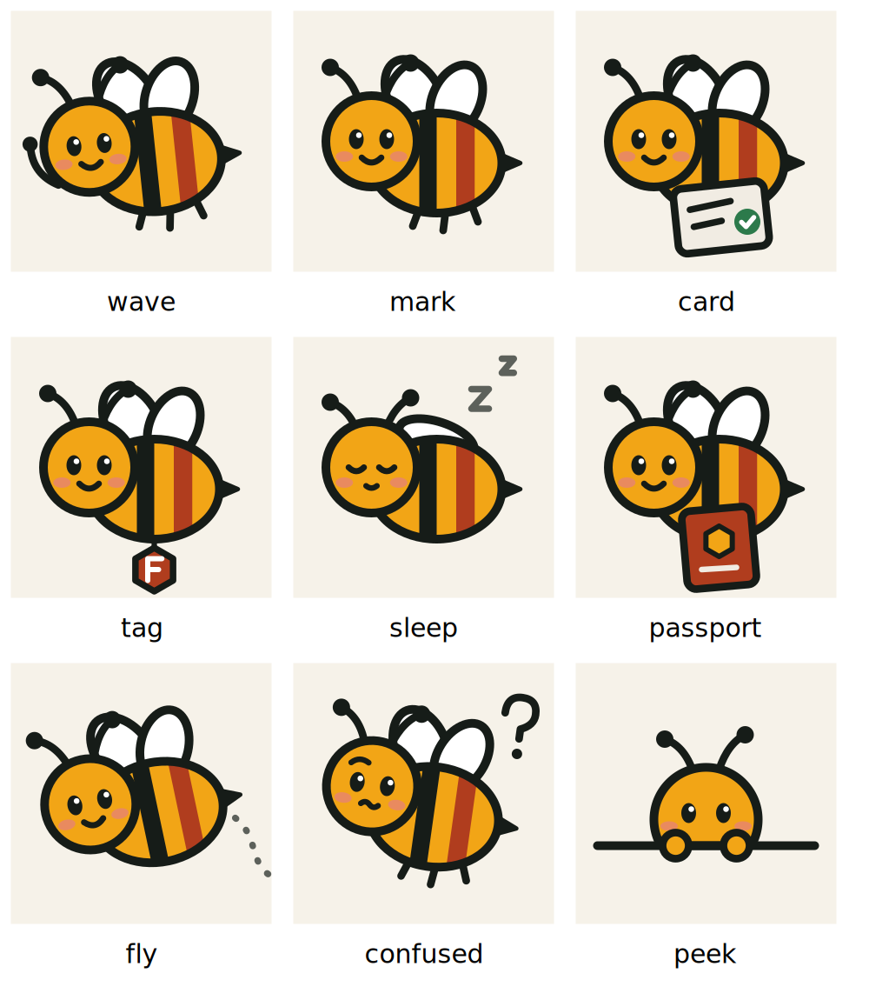
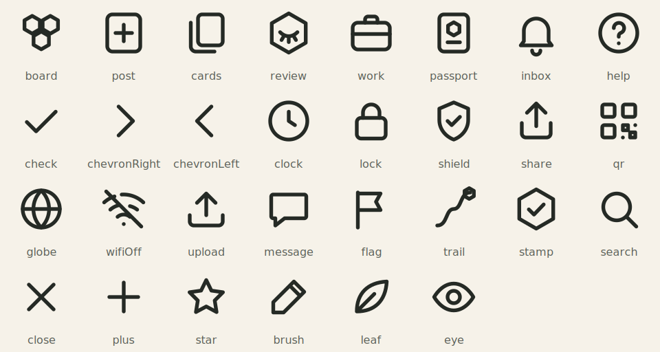

# Sajha Kaam brand: Mauri (मौरी) edition

Every choice below has a reason tied to what Sajha Kaam is (fair first jobs, blind hiring, proof that travels) or to the people using it (young Nepalis on low-cost Android phones, in two scripts). Where a choice rests on a platform guideline, the source is named.

## 1. Why a honey bee

| Bee fact | Product idea it carries |
|---|---|
| *Sajha* (साझा) means "shared"; a hive is a shared home where each worker bee works for all | The name itself |
| The waggle dance tells nest-mates exactly where the flowers are (direction + distance) | The Kaam Card: a clear "done when", not a vague ask |
| A forager is valued for what she brings back | Blind review: judged on the work, not the name (used as a metaphor, not a biology claim) |
| Honeycomb cells are filled one by one | Kaam Path and Passport stamps: one cell per confirmed job |
| Nepal has native honey-bee species, including the Himalayan giant honey bee, and beekeeping is a real livelihood at home | A career built from home, without migrating |

**Name:** Mauri (मौरी), the everyday Nepali word for honey bee. A native speaker must still confirm the name and every Mauri line (`NEPALI_REVIEW.md`).

## 2. Drawing style and why it does not look "AI-made"

Template and AI-generated apps share a look: purple-to-blue gradients, glassy cards, glowing accents, 3D blob mascots, emoji as icons, a thin coloured stripe on the left of "highlighted" cards. We avoid every one of those on purpose:

- **Flat fill + one ink outline** (4 units in a 120 box), in the spirit of Mithila painting from Janakpur and Nepali truck art: bold outline, flat colour. It is local, it reads at 24 px, and it is pure vector (no image bytes, a few KB of SVG per pose).
- **Her signature is a brick stripe.** Real bees are black and yellow; Mauri's rear stripe is the brand brick. You can tell her from a stock bee at a glance.
- **No gradients, no shadows, no glass.** Depth comes from solid colour blocks (see §3).
- **Highlights are content-shaped, not decorated:** the price sits in an ink block, the Kaam Path in a pine block, the Passport is a brick booklet with a darker spine.

One geometry file (`mobile/src/components/brand/geometry.ts`) feeds the in-app bee, the launcher icon, the splash and this sheet, so they never drift apart.

### Poses and where each is allowed

| Pose | Used for |
|---|---|
| `wave` | Language choice, welcome, Help |
| `peek` | Empty lists |
| `confused` | Errors (head tilt, no distress) |
| `sleep` | Offline banner, Lite Mode |
| `card` | A Kaam Card really posted |
| `tag` | Application really sent ("you'll appear as a letter") |
| `passport` | Work Passport cover |
| `fly` | Beside the Kaam Path |
| `mark` | Logo, icon, splash |

**Never:** on Blind Review scoring controls, next to a decision (pick, reveal, reject), or as a reward. Mauri guides; she never judges or speaks for the system.

## 3. Colour (v2: "deep")

v1 was too pale: every highlight was a tinted wash. v2 gets depth from a few **solid, saturated blocks** on a warm stone background, and no washes behind text.

| Token | Hex | Job |
|---|---|---|
| `paper` | `#F1ECE3` | Stone background. White cards separate on it without borders or shadows |
| `white` | `#FFFFFF` | Cards, inputs, tab bar |
| `brick` | `#B03D1E` | The brand block (welcome, Passport cover) and the primary button. One brick button per screen |
| `pine` | `#1C3A2E` | The worker's own record: Kaam Path block |
| `ink` | `#161C18` | Text; the dark "I want work" tile; the price block on a job; the "next step" row |
| `honey` | `#F2A516` | Small accents only: path cells, the active-tab bar, the arrow on dark tiles |
| `green` | `#2C7A4B` | "Confirmed / done" only |
| `honeyDeep` | `#9A6104` | Honey-coloured *text* on light surfaces (passes AA) |

## 4. Type (v2)

Inter is the single most common default in generated UIs, so it is gone. v2 uses two faces from **Ek Type** (Mumbai), both drawn for Devanagari *and* Latin, so a mixed नेपाली/English screen reads as one voice:

- **Anek Devanagari** (600/700): semi-condensed display face for titles and money. Strong, compact, not a stock SaaS grotesk.
- **Mukta** (400/500/600): humanist UI/body face. Google's design library reports that most of India's major newspapers use it for their online editions because it covers so many scripts.

Scale: display 34, h1 28, h2 21, money 24 (Anek); h3 17, body 16, small 14, label 13 (Mukta). Devanagari lines get +0.15 line-height. Titles are left-aligned and large; nothing is ALL-CAPS in Nepali.

## 4b. Layout rules (what makes it read as designed, not generated)

From design write-ups on the "AI look" (saasui.design, dev.to, Superdesign): the tell is the *absence of decisions*: every card weighs the same, even spacing everywhere, default fonts, pills and small-caps labels on everything, no focal point. What we do instead:

- **One focal point per screen:** the price on a job, the level on the Kaam Path, the promise on the welcome block.
- **Solid blocks, not washes:** brick / pine / ink blocks carry the key information; everything else is white on stone.
- **Status is text with a small hex mark**, not a tinted pill. **View switching is underline tabs** with counts, not chips. Chips are only for filters.
- **Section titles are real headings** in sentence case, not small uppercase "eyebrows".
- **Large left-aligned titles** that scroll with the content; a quiet top bar with only back, DEMO and one language button that names the *other* language.
- **The primary action is pinned** at the bottom when the screen is long (job detail → Apply).
- **Spacing rhythm:** 4-8 px inside a group, 16-24 px between groups.
- **Less on screen:** no subtitles under every title, no repeated taglines, the DEMO notice is one small mark in the top bar (and one line where money is handled), and workers no longer see their own name and role on their own application.

Screenshots of the v2 screens (English and Nepali, taken from the running app against the demo backend) are in `docs/screens/`.

## 5. Icons

30 icons on one 24 px grid, 1.8 stroke, round caps (`Icon.tsx`). They replace `@expo/vector-icons`, which bundles whole icon fonts. Icons that stand for *our* ideas (board, blind review, passport, stamp, Kaam Path) are built on the hexagon, so the brand lives in the icons. Symbol glyphs such as ☐ ✗ ✓ are drawn as vectors because many Android fonts lack them.

## 6. Motion

| Use | Duration | Curve |
|---|---|---|
| Press feedback (scale to 97 %) | spring, no bounce | critically damped |
| Content arriving (fade + 8 px rise) | 220 ms, stagger ≤ 180 ms | `cubic-bezier(0.05, 0.7, 0.1, 1)` (Material 3 "emphasized decelerate" style) |
| Tab icon hex, success cell | 200–260 ms | same |
| Screen push | 260 ms | platform |
| Splash sequence | ≈ 1.0 s total, tap to skip | — |

The **splash** continues the native splash with the identical picture (no jump), then: wing beats and lift-off, a short waggle run, the wordmark rising in, and a fade out once the app is ready. Google recommends an animated splash icon stay at or under 1,000 ms; we match that, and never hold the user beyond what loading needs (700 ms minimum so the bee is not a flicker).

Motion always explains something (arrived, pressed, confirmed). It is fully off with the phone's reduce-motion setting and in **Lite Mode**. There is no confetti, no looping attention-grabbers on decision screens, and no countdowns.

## 7. Logo

- **Mark:** Mauri on a brick tile with the sage "confirmed" hexagon at the bottom-right.
- **Lockups:** mark only (`Logo`), horizontal (`Brand`: mark + साझा काम + SAJHA KAAM + tagline), stacked (`BrandStacked`). The wordmark is live text, not an image.
- **Minimum size:** 24 px for the mark. **Clear space:** one quarter of the mark's width on every side.
- **Don't:** recolour the bee, add a gradient or shadow, put the mark on a busy photo, or change the stripe order.
- **Adaptive icon:** the bee sits inside the central safe zone and survives circle, squircle and rounded-square masks. The monochrome version (Android 13 themed icons) is a silhouette with the face and stripes cut out.

Regenerate everything with `npm run icons` (writes `assets/brand/*.svg`, renders the PNGs).

## 8. Assets in this folder

- `brand/mauri-poses.png`: all poses
- `brand/icon-set.png`: the icon set
- `brand/feature-graphic-1024x500.png` (+ `.svg`): store feature graphic
